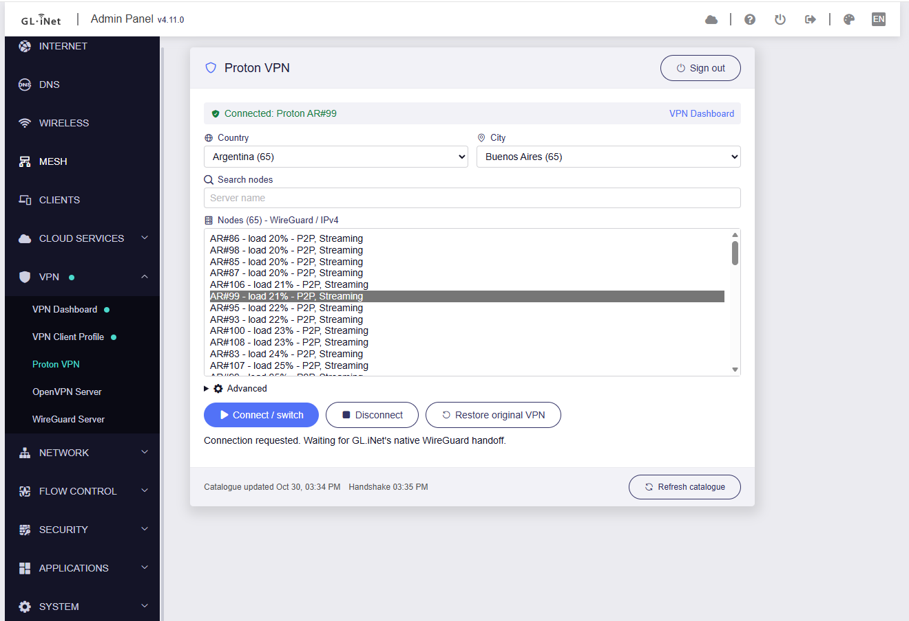

# Proton API client for GL-MT3000

Small procedural Lua client tested on **GL-MT3000, firmware 4.11.0,
OpenWrt 21.02-SNAPSHOT, aarch64_cortex-a53**. It discovers servers using an
authenticated Proton account, registers persistent WireGuard keys, and imports
and selects profiles through GL.iNet's existing VPN APIs.

It does **not** create interfaces, write UCI, or implement firewall, DNS, routing,
or a separate connection manager. GL.iNet's services own the connection and its
existing dashboard, policies, and kill switch.

> **Unofficial.** This project is not affiliated with or endorsed by Proton AG
> or GL.iNet. Proton VPN is a trademark of Proton AG. Use at your own risk.



## Components and dependencies

Layout: `src/` mirrors the installed `/usr/lib/proton-openwrt` (modules in
`src/lib/proton`), `ui/` holds the web page and its RPC plugin, `docs/` the
protocol and integration notes, and `tests/` the test suites.

The minimum components are:

- `http.lua`: pinned HTTPS using the installed libcurl.
- `crypto.lua`, `modulus.lua`, `srp.lua`: OpenSSL/musl-backed Proton authentication.
- `store.lua`, `posix.lua`: private files and locking.
- `client.lua`, `servers.lua`: authenticated API and endpoint selection.
- `profile.lua`: persistent per-server WireGuard key registration.
- `glinet.lua`, `gl_rpc.lua`: native profile/tunnel APIs through the local ubus bridge.
- `cli.lua`, `bin/proton-openwrt`, `install.sh`: CLI and POSIX ash integration.

No classes, factories, web framework, native build, or extra daemon.
All runtime dependencies are already installed on the tested router.
See [dependencies.txt](docs/dependencies.txt) for exact versions and probes.
The API client uses **Lua 5.4**. Only the small native ubus helper uses the
router's default **Lua 5.1**, whose installed ubus module cannot load in 5.4.

## Install

On the router over SSH (install or update):

```sh
curl -fsSL https://raw.githubusercontent.com/glutio/proton-openwrt/main/get.sh | sh
```

Then open **VPN -> Proton VPN** in the admin panel and sign in. See
**[INSTALL.md](INSTALL.md)** for first-tunnel setup, removal and troubleshooting.

## Optional GL.iNet web page

The additive **VPN -> Proton VPN** page reuses the saved account session and
native connection manager. It supports login/TOTP, logout, progressive country /
city / node browsing, search, connect/switch, disconnect and restoration without
manual imports. A five-minute account-scoped catalogue cache makes browsing
independent of background refreshes.
No vendor JavaScript bundles are patched. See [INSTALL.md](INSTALL.md) for setup
and [UI.md](docs/UI.md) for the provider-card limitation, HTTP precautions and verification.

## Use

Sign in (including TOTP) on the **VPN -> Proton VPN** page. The CLI reuses
that saved session over SSH:

```sh
proton-openwrt countries
proton-openwrt servers US
proton-openwrt select US
proton-openwrt prepare
```

`prepare` registers/caches the selected server's key and imports an **inactive**
profile in a dedicated **Proton CLI** native group. It does not change the
current connection. Profiles appear under **VPN -> VPN Client Profiles**.

The following command **switches the existing WireGuard tunnel**. Run it only
when a brief interruption is acceptable:

```sh
proton-openwrt connect
proton-openwrt status
```

With multiple tunnels, supply the existing tunnel ID: `connect TUNNEL_ID`.
The command saves the original profile references and enabled state, then
changes only those fields through the vendor API. Routing rules, DNS options,
and kill-switch settings are not sent or overwritten. The existing
**VPN Dashboard** continues to manage/display the tunnel.

To switch again, without importing files:

```sh
proton-openwrt select 'US-NY#102'
proton-openwrt connect
```

Choose a name returned by `servers`; availability and account entitlement are
checked again before import. Each server keeps its own key, so switching does
not revoke or rewrite earlier profiles.

To restore the connection that preceded the first `connect`, including its
original fallback profile list:

```sh
proton-openwrt restore
proton-openwrt status
```

`proton-openwrt disconnect` disables only the managed Proton tunnel, without
deleting the original-connection snapshot. `restore` remains available afterward.

Restoration does not require a Proton API session. `connect`/`restore` acknowledge
a native connection **request**, not a verified handshake. See
[GLINET.md](docs/GLINET.md) for native contracts, recovery, and connectivity checks.

Web sign-in verifies the server's SRP proof, completes TOTP if required, saves
the session, and then performs authenticated discovery. If sign-in succeeds but
discovery fails, the session remains available: retry `countries`.

`select` accepts a country code, server name, or logical server ID. Country
selection chooses the lowest-score eligible server, then load/name as
tie-breakers. It refreshes discovery and saves the selection; it does not connect.
Other commands:

```sh
proton-openwrt refresh
proton-openwrt logout
```

`refresh` rotates and saves the account tokens. Expired API access triggers one
refresh/replay automatically. Near-expiry certificates renew on use. No
scheduled daemon/cron is installed.

Each server keeps its own registration in `native-profiles.json`. Native
profile/key deletion is not automated; do not remove private state while those
profiles are still needed. `logout` revokes the API session, not the persistent
WireGuard keys; those require separate cleanup in Proton and GL.iNet.

## Storage and failure handling

State is under `/etc/proton-openwrt`: directory mode `0700`, files `0600`.
Writes use exclusive temporary files, `fsync`, and atomic rename. A nonblocking
file lock serializes CLI invocations and refresh-token rotation. Existing
non-private files, wrong owners, and symlinks are refused.

Tokens/private keys are plaintext protected by filesystem permissions, not
hardware-encrypted. Root access, router backups, or flash extraction can expose
them. Lua cannot guarantee that secret strings are erased from memory.
HTTP request/response secrets are not logged or passed to subprocess arguments.
CLI discovery remains fresh and on demand. The web page stores only allowlisted
location/load/tier metadata and its session UID in private `catalog.json`,
with a five-minute TTL. Stale locations remain browsable during refresh.
Logout or rejected refresh credentials invalidate that cache; connecting
still checks live entitlement and endpoint availability.

If registration loses its response, the pending key remains in
`native-profiles.json` and automatic duplicate registration is refused.
Certificate registration and renewal also require a valid authenticated session.

## Test

Copy `tests` to the staging directory. Its `oracle.json` contains public,
deterministic test data, not account credentials.

```sh
cd /tmp/proton-openwrt
LUA_PATH='/tmp/proton-openwrt/src/lib/?.lua;;' lua5.4 tests/run.lua
```

The tests cover signed-modulus verification, SRP client/server proofs, password
truncation/UTF-8, TOTP/scopes, token rotation, API errors, server filtering,
native registration, import/readback, switching/restoration, and private
storage. They use mock responses, not real logins or certificate creation.

Optionally regenerate the independent Python/bcrypt vectors on a development
machine; Python is **not** a router dependency:

```powershell
python -m venv .venv
.\.venv\Scripts\python -m pip install -r tests\requirements.txt
.\.venv\Scripts\python tests\oracle.py | Set-Content -Encoding utf8NoBOM tests\oracle.json
```

See [TESTING.md](docs/TESTING.md) for live validation and limitations.
API details and exact upstream functions are in
[PROTOCOL.md](docs/PROTOCOL.md).

## License

MIT; see [LICENSE](LICENSE).

## Explicit limits

- TOTP is supported; FIDO2-only/passkey authentication and recovery codes are not.
- Proton CAPTCHA/human verification is surfaced as an error, not bypassed.
- IPv4 profiles only. IPv6 is neither configured nor blocked by this program;
  review GL.iNet's own IPv6/policy settings before treating traffic as protected.
- Native integration reuses an existing WireGuard tunnel; it does not create
  routing policies or new tunnels. Use GL.iNet's UI for those.
- No local-agent connection, port forwarding, feature toggles, or background
  renewal. Native cached certificates renew on use near expiry; existing
  GL.iNet fallback/kill-switch behavior remains vendor-managed.
- Externally edited/deleted managed profiles are refused rather than silently
  overwritten. A retired physical endpoint requires selecting another server.
- Profiles are newly generated; lost private keys cannot be retrieved from
  Proton. API tokens, TLS pins, and the CLI compatibility header may require
  updates when upstream changes.
- Requests send the official Linux CLI's `x-pm-appversion` value; a generic
  value triggered human verification at login. Proton may block or change this.
- The web sign-in form sends your Proton password to the router; over plain
  HTTP it is not encrypted on the LAN.
- The FFI filesystem bindings target the verified aarch64 musl ABI.
  Other architectures/firmwares are unverified. Only the native ubus helper
  supports Lua 5.1.
